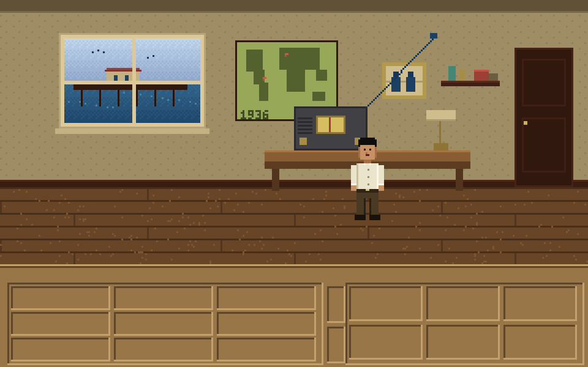

# Nick Coston

Thirteen years inside localization and dubbing pipelines, five putting generative models into them.
I'm not a developer. I build these by directing a coding agent: I decide what gets made and how good it has to be.

[nccoston.com](https://nccoston.com) · [LinkedIn](https://www.linkedin.com/in/nccoston) · [All four, on one page](https://nccoston.github.io/nccoston/)

## Dub Room

**[Open the scene](https://nccoston.github.io/nccoston/dub.html)** · [code](dub.html)

One scene, carried into Spanish twice: once as a literal translation, once as an adapted dub. Both are measured
against the same picture for timing and lip closures. The picture's mouths follow the English performance, so when
a line runs long you see the voice keep going after the lips stop. Every line carries the director's note on why
it reads the way it does, including the ones where the literal translation already fit.

## Show Prep

**[How it works](https://nccoston.github.io/nccoston/showprep.html)** · [code](showprep/)

Weekly prep for a team podcast, built by an agent the night after the game: a talk track, a deck and a graphic for
every card. It started as the prep for Michigan Weekly, which I co-host on Blue By Ninety. An eval checks that every
number traces to a source, including when a fact is missing, two sources disagree, or a fact tries to give the
model orders.

## Brij and the Long Wave

An original 1930s pulp mystery adventure, written for the real SCUMM engine. It compiles to SCUMM v6 bytecode with
ScummC and runs in stock ScummVM. Brij runs a radio repair shop on the Santa Monica pier in 1936. Both his parents
are missing, and every night at ten past three his set picks up a signal that shouldn't exist. The look and
structure honour *Indiana Jones and the Fate of Atlantis*. The story, characters and art are original.

## The Victors

**[The board](https://the-victors-board.onrender.com/)** · [the write-up](https://the-victors-board.onrender.com/story) · [code](https://github.com/nccoston/nccoston/tree/claude/boards2go-migration-m2tgaf/victors-board)

A Michigan message board that had run continuously since 1995 lost its host and died. I rebuilt it in six days:
Python, SQLite, plain HTML, $7 a month. I kept the 1998 look the members wanted and added photo uploads, polls,
live scoreboards and two custom games. About 350 members use it. The write-up includes the incident log: the real
production failures and what I did about each one.
